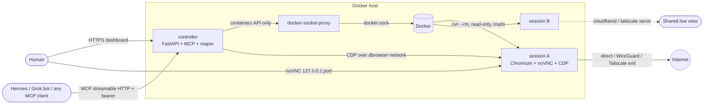
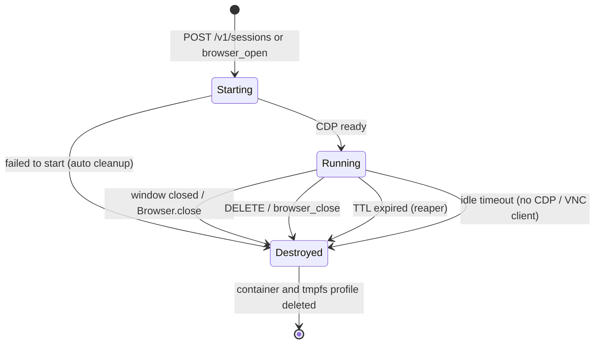

# Disposable Browser

Private Chromium sessions that leave nothing behind, for people and for AI agents. Each session runs in its own container with DuckDuckGo search and hardened privacy policies. It can route traffic through WireGuard or Tailscale, and share its live view through Cloudflare Tunnel or Tailscale Serve. Close the window, call `DELETE`, or let the TTL run out, and the container goes with its tmpfs profile, so cookies, history, cache and storage are gone. The next session starts clean.

[](https://github.com/kyroskoh/disposable-browser/actions/workflows/ci.yml)
[](LICENSE.md)
[](https://github.com/kyroskoh/disposable-browser/releases)
[](ROADMAP.md)
[](docker-compose.yml)
[](examples/mcp-clients.md)

**Version:** 0.1.0 · **Live demo:** self-hosted (see [Getting Started](#-getting-started)) · **Changelog:** [CHANGELOG.md](./CHANGELOG.md)

## 🚀 Features

### Disposable by Design
- **One container per session**: read-only rootfs, tmpfs profile, `--rm`. When Chromium exits, the session is destroyed.
- **Many ways to end a session**: close the window, call `Browser.close`, `DELETE` it, let its TTL expire, or leave it idle past its idle timeout. Each one removes everything.
- **A fresh identity on demand**: `fresh=true` / `reuse=false` throws away the old session and starts a clean one.

### Privacy-First Chromium
- **DuckDuckGo** is the default search, home page and new-tab page, set by managed policy.
- **Off by default**: sync, sign-in, password manager, autofill, telemetry, translate and Privacy Sandbox.
- **Blocked**: third-party cookies; geolocation, camera, microphone and other sensors are denied.
- **No IP leak through WebRTC**: `WebRtcIPHandling=disable_non_proxied_udp`.
- **Ad and tracker blocking** with a bundled, pinned [uBlock Origin Lite](https://github.com/uBlockOrigin/uBOL-home) (MV3). It's on by default and can be turned off per session.
- **Optional DNS-over-HTTPS** for all sessions.

### Networking per Session
- **WireGuard**: bring a `.conf`; an iptables kill switch is on by default.
- **Tailscale**: userspace mode with in-memory state and an optional exit node.
- **Sharing the live view**: a Cloudflare quick or named tunnel, or Tailscale Serve.

### Built for AI Agents
- **CDP endpoint** for Playwright or Puppeteer on every session.
- **MCP server** (Streamable HTTP + stdio) for Hermes Agents, Grok bots, Claude, Cursor and more.
- **One browser per agent**, enforced by per-agent tokens. Agents can't see or drive each other's sessions.
- **Per-agent quotas**: cap TTL and idle time, and restrict networks, exposure and WireGuard profiles per agent.
- **Rich MCP tools**: tabs, back/forward, wait-for, and an accessibility-tree snapshot alongside navigate, click, type and screenshot.

### Two Ways to Use It
- **Standalone**: `scripts/browse.sh` or `browse.ps1` starts one throwaway browser, no controller needed.
- **Managed**: a dashboard, REST API, MCP server and TTL reaper for fleets of sessions.

## 🏗️ Architecture





```
disposable-browser/
├── browser/            # Chromium image: Dockerfile, entrypoint.sh (networking + lifecycle), policies/
├── controller/         # Python package: REST API, MCP server, session manager, dashboard, tests
├── deploy/tailscale/   # Tailscale Serve config for remote controller access
├── examples/           # Hermes / Grok-bot multi-agent, MCP clients, Playwright
├── scripts/            # browse.sh / browse.ps1 (standalone), smoke-standalone.sh
├── wireguard/          # your <profile>.conf files (git-ignored)
└── docs/adr/           # architecture decision records
```

### Tech Stack

**Browser image**
- Debian bookworm-slim, Chromium, Xvfb, x11vnc, noVNC/websockify, socat (CDP)
- wireguard-tools + iptables, tailscale, cloudflared, tini
- uBlock Origin Lite (pinned, SHA-256 verified at build time)

**Controller**
- Python 3.12, FastAPI + Uvicorn, Pydantic v2
- Docker SDK for Python; the controller is stateless, with Docker labels as the source of truth
- MCP Python SDK 2.x (`MCPServer`, Streamable HTTP), Playwright (CDP client)

**Infrastructure**
- Docker Compose with a least-privilege `docker-socket-proxy` and optional `cloudflare` / `tailscale` profiles
- GitHub Actions: ruff, pytest, shellcheck, hadolint, smoke and e2e tests on real Docker
- Multi-arch (amd64 + arm64) release images on GHCR, cosign-signed, with SBOM and provenance

## 🚦 Getting Started

### Prerequisites
- Docker Engine 24+ with Compose v2 (Linux), or Docker Desktop (Windows/macOS)
- Python 3.11+ (only for development or running the tests)

### Installation
```bash
git clone https://github.com/kyroskoh/disposable-browser.git
cd disposable-browser
cp .env.example .env                    # set DBROWSER_API_TOKEN (openssl rand -hex 24)
```

### Using Docker (Recommended)
```bash
docker compose --profile build build    # builds browser + controller images
docker compose up -d                    # dashboard: http://localhost:8080
```

### Using the Release Images (GHCR)
Tagged releases publish signed `linux/amd64` and `linux/arm64` images. Add these to `.env`:

```bash
DBROWSER_BROWSER_IMAGE=ghcr.io/kyroskoh/disposable-browser-browser:0.2
DBROWSER_CONTROLLER_IMAGE=ghcr.io/kyroskoh/disposable-browser-controller:0.2
```

```bash
docker pull ghcr.io/kyroskoh/disposable-browser-browser:0.2   # the controller can't pull images itself
docker compose up -d

# Optional: verify the signature (keyless, issued to this repository's release workflow)
cosign verify ghcr.io/kyroskoh/disposable-browser-browser:0.2 \
  --certificate-identity-regexp '^https://github.com/kyroskoh/disposable-browser/' \
  --certificate-oidc-issuer https://token.actions.githubusercontent.com
```

### Just One Browser (no controller)
```bash
docker build -t disposable-browser/browser:dev browser
scripts/browse.sh                       # prints a noVNC URL; close Chromium to destroy everything
scripts/browse.sh --wg ~/vpn/wg0.conf   # same, through WireGuard with a kill switch
# Windows: powershell -File scripts/browse.ps1
```

## 📊 Usage

### Web Interface
1. Open `http://localhost:8080` and paste your API token.
2. Pick the egress (Direct, WireGuard or Tailscale), the sharing option, the lifetime, the idle timeout and ad blocking, then click **Start fresh browser**.
3. The live view opens in a new tab. Use **Destroy** to delete the session (or just close Chromium).

### API Usage
All `/v1` calls need `Authorization: Bearer $DBROWSER_API_TOKEN`.

```bash
# Create a session through a WireGuard profile, valid for 15 minutes
curl -s -H "Authorization: Bearer $T" -H 'Content-Type: application/json' \
  -d '{"agent_id":"grok-bot","network":"wireguard","wireguard_profile":"mullvad-sg","ttl_seconds":900}' \
  http://localhost:8080/v1/sessions

# List / inspect / destroy
curl -s -H "Authorization: Bearer $T" http://localhost:8080/v1/sessions
curl -s -H "Authorization: Bearer $T" http://localhost:8080/v1/sessions/<id>
curl -s -X DELETE -H "Authorization: Bearer $T" http://localhost:8080/v1/sessions/<id>
```

| Method | Path | Description |
|---|---|---|
| `POST` | `/v1/sessions` | Create a session. Returns `id`, `viewer_url`, `cdp_url`, `public_url`, `expires_at`. |
| `GET` | `/v1/sessions` | List live sessions |
| `GET` | `/v1/sessions/{id}` | One session (`404` once closed or expired) |
| `DELETE` | `/v1/sessions/{id}` | Destroy the session now |
| `GET` | `/healthz` | Liveness (no auth) |

Request fields:

| Field | Values |
|---|---|
| `agent_id` | Owner. An agent gets one session; set `reuse:false` to replace it with a fresh one. |
| `network` | `direct` (default), `wireguard` (needs `wireguard_profile`), `tailscale` (optional `tailscale_exit_node`) |
| `expose` | `none` (default), `cloudflare`, `tailscale` |
| `ttl_seconds` | Defaults to 3600. Capped by `DBROWSER_MAX_TTL_SECONDS` and the agent's quota. |
| `idle_timeout_seconds` | Destroy after this long with no CDP or VNC client. `0` turns it off, otherwise `>= 30`. Defaults to `DBROWSER_IDLE_TIMEOUT_SECONDS`. |
| `adblock` | `true` / `false`: load uBlock Origin Lite. Defaults to `DBROWSER_ADBLOCK`. |
| `start_url` | Defaults to `https://duckduckgo.com/` |

A request that an agent's quota forbids returns `403` (see [Per-agent quotas](#per-agent-quotas)).

### MCP & AI Agents
- Endpoint: `http://localhost:8080/mcp/` (Streamable HTTP), plus a `dbrowser-mcp` stdio entry point.
- Tools:

| Tool | What it does |
|---|---|
| `browser_open` / `browser_close` / `browser_list` | Get, replace (`fresh`), destroy or list your session. Takes `network`, `expose`, `ttl_seconds`, `idle_timeout_seconds`, `adblock`. |
| `browser_navigate` | Go to a URL; plain words become a DuckDuckGo search |
| `browser_back` / `browser_forward` | History navigation; `moved=false` when there is nothing to go to |
| `browser_tabs` | `action` is `list`, `new`, `select` or `close`. Other tools act on the active tab. The last tab can't be closed. |
| `browser_snapshot` | Page text plus up to 100 links |
| `browser_accessibility_snapshot` | ARIA tree as YAML (roles, names, states), handy for `role=button[name="..."]` selectors |
| `browser_wait_for` | Wait for a selector or text to be `visible`, `hidden`, `attached` or `detached` (up to 60 s) |
| `browser_click` / `browser_type` / `browser_evaluate` / `browser_screenshot` | Interact with and capture the page |

- Client setup is in [examples/mcp-clients.md](examples/mcp-clients.md), and Hermes / Grok bot fleets in [examples/hermes/](examples/hermes/multi-agent.md).
- To give each agent its own isolated browser, set `DBROWSER_AGENT_TOKENS=agent-a:<token>,agent-b:<token>`.
- Tool errors an agent can act on (quota refusals, a missing selector, a bad tab index) come back with their reason. Unexpected failures stay generic.

### Per-agent quotas
`DBROWSER_AGENT_QUOTAS` is a JSON object keyed by agent id. The `"*"` entry applies to every agent that has no entry of its own, and an agent's own entry replaces `"*"` entirely. Sessions created without an `agent_id` aren't subject to quotas.

```json
{
  "*":        {"max_ttl_seconds": 1800, "max_idle_timeout_seconds": 600, "expose": ["none"]},
  "grok-bot": {"networks": ["wireguard"], "wireguard_profiles": ["mullvad-sg"], "max_ttl_seconds": 900},
  "trusted":  {}
}
```

| Key | Effect |
|---|---|
| `max_ttl_seconds` | Caps the session lifetime (silently, like the global cap) |
| `max_idle_timeout_seconds` | Caps the idle timeout. It also turns one on when the request asks for none. |
| `networks` / `expose` | Allowed values. Anything else is refused with `403`. |
| `wireguard_profiles` | Allowed WireGuard profile names |

Each agent can only ever hold one session, so there's no per-agent session count. `DBROWSER_MAX_SESSIONS` caps the total.

### Networking Options
| Need | How |
|---|---|
| Hide your IP behind a VPN | Put `wireguard/<name>.conf` in place and use `network=wireguard`. The kill switch blocks non-tunnel egress. |
| Exit through a machine on your tailnet | Set `DBROWSER_TAILSCALE_AUTHKEY` (ephemeral key) and use `network=tailscale` with `tailscale_exit_node`. |
| Let someone watch or drive a session | `expose=cloudflare` (quick tunnel, no account needed) or `expose=tailscale` |

## 🧪 Testing

```bash
cd controller
ruff check . && ruff format --check .
pytest                                   # 71 unit tests: fake Docker, real MCP over HTTP

# End-to-end against real Docker (CI runs this on every push)
docker compose --profile build build && docker compose up -d
bash ../scripts/smoke-standalone.sh      # standalone image: CDP, noVNC, close = removed
DBROWSER_API_TOKEN=... pytest -m integration tests/integration
```

The end-to-end suite checks that the DuckDuckGo and privacy policies are active, that closing the browser destroys the session, that a new session starts with no cookies or storage, that MCP can drive a real browser (including tabs, history, wait-for and the accessibility snapshot), that uBlock Origin Lite loads (and stays off when disabled), that an idle session destroys itself, and that the Cloudflare quick tunnel works.

## 🛠️ Development

### Project Structure
| Path | Purpose |
|---|---|
| `controller/src/dbrowser/sessions.py` | Session lifecycle core (create, reuse, limits, quotas, TTL reaping, readiness) |
| `controller/src/dbrowser/runtime.py` | Docker seam (`Runtime` protocol + `DockerRuntime`) |
| `controller/src/dbrowser/api.py` | REST, dashboard, bearer / per-agent auth middleware |
| `controller/src/dbrowser/mcp_server.py` | MCP tools and agent isolation |
| `controller/src/dbrowser/browser_ops.py` | Playwright operations over CDP |
| `browser/entrypoint.sh` | Egress setup, display/VNC, exposure, ad blocking, idle watchdog, Chromium lifecycle |

### Available Scripts
```bash
scripts/browse.sh [--wg wg0.conf]   # standalone disposable browser (Linux/macOS)
scripts/browse.ps1                  # standalone disposable browser (Windows)
scripts/smoke-standalone.sh         # image smoke test
dbrowser --port 8080                # run the controller from source
dbrowser-mcp                        # stdio MCP server using local Docker
```

## 🔧 Configuration

### Environment Variables
| Variable | Default | Description |
|---|---|---|
| `DBROWSER_API_TOKEN` | *(generated per run)* | Admin token for dashboard, REST and MCP |
| `DBROWSER_AGENT_TOKENS` | | `agent:token,...`: each agent gets its own isolated browser over MCP |
| `DBROWSER_BROWSER_IMAGE` | `disposable-browser/browser:dev` | Image launched for each session |
| `DBROWSER_CONTROLLER_IMAGE` | `disposable-browser/controller:dev` | Controller image used by Compose (set to the GHCR image to skip building) |
| `DBROWSER_MAX_SESSIONS` | `10` | Maximum concurrent sessions |
| `DBROWSER_DEFAULT_TTL_SECONDS` / `DBROWSER_MAX_TTL_SECONDS` | `3600` / `86400` | Session lifetime |
| `DBROWSER_PUBLIC_HOST` / `DBROWSER_PUBLISH_BIND` | `localhost` / `127.0.0.1` | Host used in returned URLs, and the interface session ports bind to |
| `DBROWSER_MEMORY_LIMIT` / `DBROWSER_SHM_SIZE` / `DBROWSER_CPUS` | `2g` / `1g` / `1.0` | Resource limits per session |
| `DBROWSER_IDLE_TIMEOUT_SECONDS` | `0` (off) | Default idle timeout. Without a CDP or VNC client for this long, a session is destroyed (`>= 30`). |
| `DBROWSER_ADBLOCK` | `true` | Load uBlock Origin Lite in sessions by default |
| `DBROWSER_AGENT_QUOTAS` | | Per-agent limits as JSON (see [Per-agent quotas](#per-agent-quotas)) |
| `DBROWSER_DOH_TEMPLATE` | | DNS-over-HTTPS template, e.g. `https://dns.quad9.net/dns-query` |
| `DBROWSER_TAILSCALE_AUTHKEY` | | Ephemeral auth key for `tailscale` network/expose |
| `DBROWSER_CLOUDFLARE_TUNNEL_TOKEN` / `_HOSTNAME` | | Named tunnel (empty means a free quick tunnel) |

See [.env.example](.env.example) for the annotated list.

## 🚀 Deployment

```bash
docker compose --profile build build
docker compose up -d
curl -fsS http://localhost:8080/healthz          # {"status":"ok",...}
```

Remote access to the dashboard and MCP, without opening any ports:

```bash
docker compose --profile tailscale up -d    # https://dbrowser.<tailnet>.ts.net (needs TS_AUTHKEY)
docker compose --profile cloudflare up -d   # named tunnel (needs CLOUDFLARE_TUNNEL_TOKEN); add Cloudflare Access
```

Read [SECURITY.md](SECURITY.md) before exposing anything. The controller reaches Docker only through `docker-socket-proxy`, but permission to create containers is still powerful.

## 🤝 Contributing

1. Fork the repository
2. Create a feature branch (`git checkout -b feat/amazing-feature`)
3. Commit using Conventional Commits (`git commit -m 'feat: add amazing feature'`)
4. Push to the branch (`git push origin feat/amazing-feature`)
5. Open a Pull Request

### Development Guidelines
- Ruff lint and format must be clean; shellcheck and hadolint must pass
- Write tests for new features (unit tests with `FakeRuntime`; e2e for anything touching the image)
- Never add persistence for session data (see PRD non-goals)
- Update documentation and CHANGELOG `[Unreleased]` for user-visible changes

See [CONTRIBUTING.md](CONTRIBUTING.md) for details.

## 📈 Roadmap

### Phase 1: Core MVP (v0.1)
- [x] Disposable Chromium sessions with DuckDuckGo and privacy policies
- [x] WireGuard / Tailscale egress, Cloudflare / Tailscale sharing
- [x] REST API, dashboard and MCP server with one browser per agent
- [x] CI with end-to-end tests on real Docker

### Phase 2: Hardening & Distribution (Current, v0.2)
- [x] Multi-arch images on GHCR, docker-socket-proxy, idle timeout, per-agent quotas
- [x] More MCP tools (tabs, back/forward, wait-for, accessibility snapshot), bundled uBlock Origin Lite

### Phase 3: Security & Privacy Depth (v0.3)
- [ ] DNS profiles (AdGuard DNS, Quad9, Mullvad, NextDNS, Pi-hole / AdGuard Home), egress guard against LAN and metadata access
- [ ] Authenticated CDP, token-gated viewer, image scanning and scheduled rebuilds, secrets off the environment
- [ ] Chromium sandbox with seccomp, download hand-off, audio and clipboard

### Phase 4: Platform (v0.4 to v1.0)
- [ ] Metrics and tracing, OIDC login, rate limiting and audit log, proxy/Tor egress
- [ ] Alternative engines, Kubernetes runtime, frozen API contract and external security review

See [ROADMAP.md](ROADMAP.md) and [ENHANCEMENT.md](ENHANCEMENT.md).

## 📄 License

This project is licensed under the MIT License. See [LICENSE.md](LICENSE.md) for details.

## 📦 Key libraries (maintained)

| Concern | Package | Notes |
|---------|---------|--------|
| HTTP API | `fastapi` >=0.115, `uvicorn` >=0.30 | REST, dashboard, ASGI auth middleware |
| MCP | `mcp` >=2.3,<3 | `MCPServer` + Streamable HTTP (stateless) |
| Browser automation | `playwright` >=1.48 | `connect_over_cdp`; no bundled browsers needed |
| Container runtime | `docker` >=7.1 | Behind the `Runtime` protocol, so it can be swapped |
| Config / validation | `pydantic` v2, `pydantic-settings` | Typed `DBROWSER_*` settings and request validation |
| Browser | Debian `chromium` | Tracks Debian security updates; rebuild regularly |

## 🙏 Acknowledgments

- [Chromium](https://www.chromium.org/) and its enterprise policy system
- [DuckDuckGo](https://duckduckgo.com/) for private search
- [noVNC](https://novnc.com/), [x11vnc](https://github.com/LibVNC/x11vnc) and Xvfb for the live view
- [WireGuard](https://www.wireguard.com/), [Tailscale](https://tailscale.com/) and [Cloudflare Tunnel](https://developers.cloudflare.com/cloudflare-one/connections/connect-networks/) for private networking
- [Model Context Protocol](https://modelcontextprotocol.io/) and [Hermes Agent](https://github.com/NousResearch/hermes-agent) for agent integration
- [Playwright](https://playwright.dev/) for CDP automation
- Community feedback and contributions

## 📞 Support

- 🐛 Issues: [GitHub Issues](https://github.com/kyroskoh/disposable-browser/issues)
- 💬 Discussions: [GitHub Discussions](https://github.com/kyroskoh/disposable-browser/discussions)
- 🔒 Security: see [SECURITY.md](SECURITY.md) (private advisories, not public issues)

---

Made with ❤️ by [Kyros Koh](https://github.com/kyroskoh)
