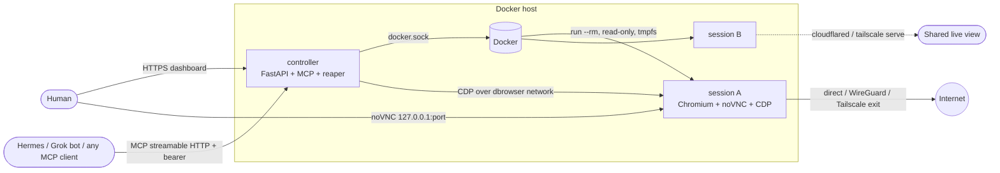
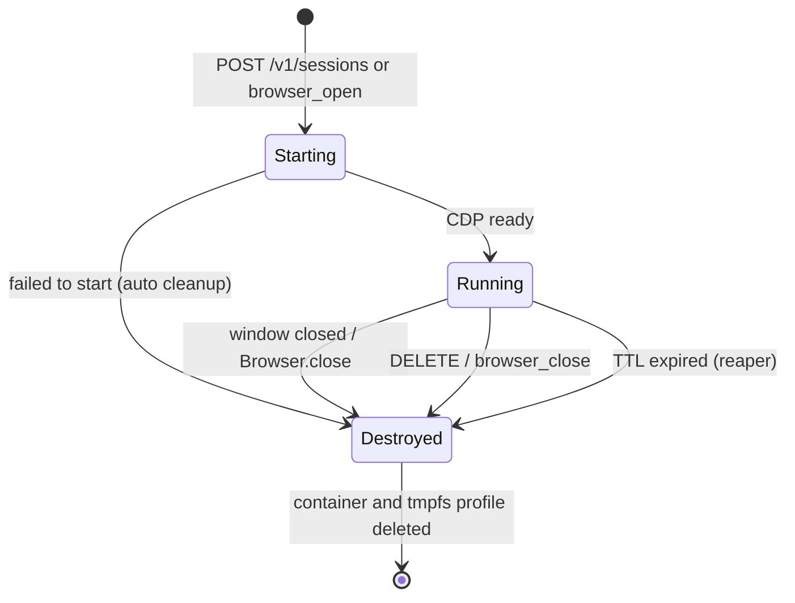

# Disposable Browser

**Private Chromium sessions that leave nothing behind**, for people and for AI agents.
Each session is its own container: DuckDuckGo search, hardened privacy policies, optional
WireGuard / Tailscale egress, and optional sharing through Cloudflare Tunnel or Tailscale Serve.
Close the window, call `DELETE`, or let the TTL run out, and the container goes with its
tmpfs profile, so cookies, history, cache and storage are gone. The next session starts clean.

[](https://github.com/kyroskoh/disposable-browser/actions/workflows/ci.yml)
[](LICENSE.md)
[](https://github.com/kyroskoh/disposable-browser/releases)
[](ROADMAP.md)
[](docker-compose.yml)
[](examples/mcp-clients.md)

## Features

- **Disposable by design.** Each session runs in a read-only container with a tmpfs profile and `--rm`. When Chromium exits, the session is destroyed.
- **Privacy-first Chromium.** DuckDuckGo is the default search, home and new-tab page. Sync, sign-in, password manager, autofill, telemetry, translate and Privacy Sandbox are off. Third-party cookies are blocked, and WebRTC can't leak your IP.
- **Egress per session:** `direct`, `wireguard` (bring a `.conf`; kill switch on by default), or `tailscale` (userspace mode, optional exit node, in-memory state).
- **Live view per session:** noVNC in your browser, which you can share with a Cloudflare quick or named tunnel, or with Tailscale Serve.
- **Agent-ready.**
  - Every session gets a CDP endpoint for Playwright or Puppeteer.
  - A built-in **MCP server** (`/mcp/`) works with Hermes Agents, Grok bots, Claude, Cursor and others.
  - **One browser per agent**, enforced with per-agent tokens.
- **Two ways to use it.**
  - On its own: `scripts/browse.sh` runs a single throwaway browser.
  - With the controller: a dashboard, REST API and MCP server for fleets of sessions.

## Architecture





## Quickstart

Requirements: Docker Engine 24+ with Compose v2, on Linux, macOS or Windows (Docker Desktop).

```bash
git clone https://github.com/kyroskoh/disposable-browser && cd disposable-browser
cp .env.example .env                       # set DBROWSER_API_TOKEN (openssl rand -hex 24)
# Linux only: let the non-root controller use the Docker socket
echo "DOCKER_GID=$(getent group docker | cut -d: -f3)" >> .env
docker compose --profile build build       # builds browser + controller images
docker compose up -d
open http://localhost:8080                 # paste your token, click "Start fresh browser"
```

### Just one browser, no controller

```bash
docker build -t disposable-browser/browser:dev browser
scripts/browse.sh                    # prints a noVNC URL; close Chromium to destroy everything
scripts/browse.sh --wg ~/vpn/wg0.conf     # same, through WireGuard with a kill switch
# Windows: powershell -File scripts/browse.ps1
```

## REST API

All `/v1` calls need `Authorization: Bearer $DBROWSER_API_TOKEN`.

| Method | Path | Description |
|---|---|---|
| `POST` | `/v1/sessions` | Create a session. Returns `id`, `viewer_url`, `cdp_url`, `public_url`, `expires_at`. |
| `GET` | `/v1/sessions` | List live sessions |
| `GET` | `/v1/sessions/{id}` | One session (`404` once it is closed or expired) |
| `DELETE` | `/v1/sessions/{id}` | Destroy the session now |
| `GET` | `/healthz` | Liveness (no auth) |

```bash
curl -s -H "Authorization: Bearer $T" -H 'Content-Type: application/json' \
  -d '{"agent_id":"grok-bot","network":"wireguard","wireguard_profile":"mullvad-sg","ttl_seconds":900}' \
  http://localhost:8080/v1/sessions
```

Request fields:

| Field | Values |
|---|---|
| `agent_id` | Owner. An agent gets one session; set `reuse:false` to replace it with a fresh one. |
| `network` | `direct` (default), `wireguard` (needs `wireguard_profile`), `tailscale` (optional `tailscale_exit_node`) |
| `expose` | `none` (default), `cloudflare`, `tailscale` |
| `ttl_seconds` | Defaults to 3600. Capped by `DBROWSER_MAX_TTL_SECONDS`. |
| `start_url` | Defaults to `https://duckduckgo.com/` |

## MCP and AI agents

- Endpoint: `http://localhost:8080/mcp/` (Streamable HTTP), plus a `dbrowser-mcp` stdio entry point.
- Tools: `browser_open`, `browser_navigate`, `browser_snapshot`, `browser_screenshot`, `browser_click`, `browser_type`, `browser_evaluate`, `browser_list`, `browser_close`.
- Client setup is in [examples/mcp-clients.md](examples/mcp-clients.md), and Hermes / Grok bot fleets in [examples/hermes/](examples/hermes/multi-agent.md).
- To give each agent its own isolated browser, set `DBROWSER_AGENT_TOKENS=agent-a:<token>,agent-b:<token>`.

## Networking options

| Need | How |
|---|---|
| Hide your IP behind a commercial or self-hosted VPN | Put `wireguard/<name>.conf` in place and use `network=wireguard`. A kill switch (iptables) blocks non-tunnel egress. |
| Exit through a machine on your tailnet | Set `DBROWSER_TAILSCALE_AUTHKEY` (ephemeral key) and use `network=tailscale` with `tailscale_exit_node`. |
| Let someone watch or drive a session remotely | `expose=cloudflare` (a quick tunnel with no account, or set a named tunnel token) or `expose=tailscale`. |
| Reach the dashboard and MCP remotely | `docker compose --profile tailscale up -d` or `--profile cloudflare` (put Cloudflare Access in front) |

## Configuration

Everything is configured through `DBROWSER_*` environment variables. See [.env.example](.env.example) for the full annotated list.

## Development and testing

```bash
cd controller && python -m venv .venv && . .venv/bin/activate && pip install -e ".[dev]"
ruff check . && pytest                      # unit tests (fake Docker, real MCP over HTTP)
# end-to-end against real Docker (CI runs this on every push):
docker compose --profile build build && docker compose up -d
bash scripts/smoke-standalone.sh
DBROWSER_API_TOKEN=... pytest -m integration tests/integration
```

## Documentation

- [PRD.md](PRD.md): product requirements
- [ROADMAP.md](ROADMAP.md): Now / Next / Later
- [ENHANCEMENT.md](ENHANCEMENT.md): proposals and backlog
- [CHANGELOG.md](CHANGELOG.md)
- [CONTRIBUTION.md](CONTRIBUTION.md): how to contribute
- [SECURITY.md](SECURITY.md): threat model and disclosure
- [docs/adr/](docs/adr/): architecture decisions

## License

MIT. See [LICENSE.md](LICENSE.md).
